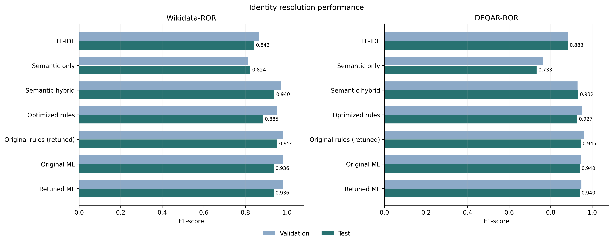
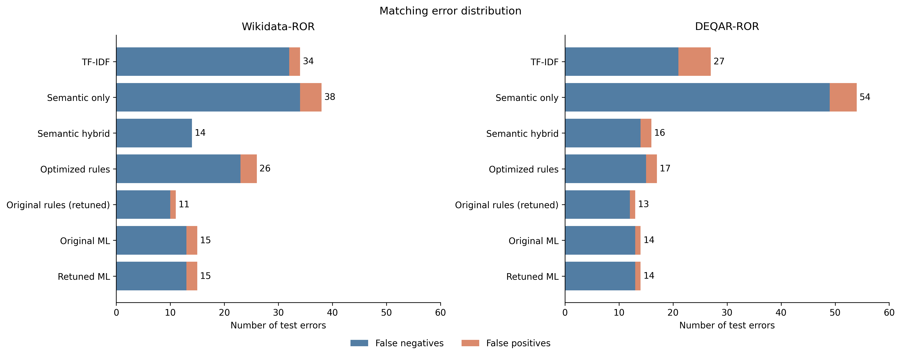
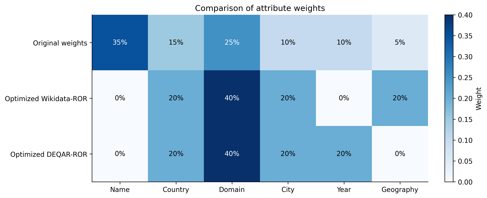

# Identity Resolution Extensions

## Overview

This work extends the existing higher education institution
identity resolution pipeline for the Web Data Integration
project (HWS 2026).

Author: Sanjeevani Rajpurohit

The extensions investigate three additional approaches:
statistical text similarity, multilingual semantic matching,
and systematic rule weight optimization.

## Datasets

- Wikidata: 22,697 records
- ROR: 30,131 records
- DEQAR: 8,979 records

ROR serves as the connector dataset.

## Implemented approaches

### 1. TF-IDF matching

- Word-level n-grams (1-2)
- Character-level n-grams (3-5)
- Cosine similarity
- Primary and alternative institution names
- Validation-based threshold selection

### 2. Multilingual semantic matching

- paraphrase-multilingual-MiniLM-L12-v2
- 384-dimensional embeddings
- Semantic cosine similarity
- Hybrid matching with country and website domain
- Batched CPU inference

### 3. Optimized rule-based matching

- Six similarity features
- Cached feature matrices
- 252 systematic weight combinations
- Training-based configuration screening
- Validation-based threshold optimization
- Comparison against original manually assigned weights

All approaches use the same regenerated Round 3 blocking
candidates and greedy one-to-one matching.

## Final performance

Test F1-scores:

| Method | Wikidata-ROR | DEQAR-ROR |
|---|---:|---:|
| TF-IDF | 0.8426 | 0.8831 |
| Semantic only | 0.8241 | 0.7327 |
| Semantic hybrid | 0.9397 | 0.9316 |
| Optimized rules | 0.8850 | 0.9270 |
| Original rules, retuned | **0.9536** | **0.9447** |
| Original ML | 0.9362 | 0.9402 |
| Retuned ML | 0.9362 | 0.9402 |

## Implementation

| Script | Purpose |
|---|---|
| regenerate_candidates.py | CPU-based blocking regeneration |
| tfidf_matching.py | Initial TF-IDF experiments |
| tfidf_refined.py | Alternative names and threshold optimization |
| semantic_matching.py | Multilingual and hybrid matching |
| extract_rule_features.py | Cached similarity feature extraction |
| optimized_rules.py | Weight and threshold optimization |
| reproduce_baselines.py | Controlled ML baseline reproduction |
| freeze_configurations.py | Freeze selected predictions |
| evaluate_final.py | Final test evaluation |
| error_analysis.py | Error diagnostics and review sampling |
| verify_extensions.py | Regression and integrity verification |
| plot_results.py | Report visualizations |

## Reproducibility

Environment:
- Python 3.12.16
- Apple Silicon ARM64
- PyDI 0.2.1
- CPU-based embedding execution

Dependencies are recorded in
[requirements-identity-resolution-lock.txt](../../../requirements-identity-resolution-lock.txt).

The saved experimental predictions, summary metrics and
configuration manifests are version-controlled.

Blocking candidates and feature caches are excluded from Git.

### Reproduction order

Execute the following scripts from the repository root,
using an isolated environment:

1. regenerate_candidates.py
2. tfidf_matching.py
3. tfidf_refined.py
4. semantic_matching.py
5. extract_rule_features.py
6. optimized_rules.py
7. reproduce_baselines.py
8. freeze_configurations.py
9. evaluate_final.py
10. error_analysis.py
11. verify_extensions.py
12. plot_results.py

Use the following command pattern:

    python -u scripts/identity_resolution/06_extensions/SCRIPT.py

Full reproduction should be performed in a separate working
copy with a fresh configuration-freeze output. Do not
overwrite the archived experimental results.

Exact candidate and prediction reproduction may depend
on package versions, model revisions and tie-breaking.

## Visualizations

### Matching performance

### Error distribution

### Attribute weights

## Documentation

- [Experimental journal](../../../IDENTITY_RESOLUTION_EXTENSIONS.md)
- [Report contribution](REPORT_CONTRIBUTION.md)
- [Final test results](results/final_evaluation/test_results.csv)
- [Error analysis](results/final_evaluation/error_analysis/)

## Limitations

- Existing test sets were previously evaluated.
- Full human ground-truth verification remains pending.
- Evaluation metrics cover labeled pairs only.
- Improvements have not been tested for statistical significance.
- The additional correspondence review is not representative
  of all generated matches.
